# IBM Z Job Debugger — Architecture

**In one line:** You paste a Prow CI job link. The web app (in your browser) downloads the job’s public logs and files from Google Cloud Storage, then shows a clear debug page for IBM Z OpenShift jobs. There is no app server, no API keys, and no private buckets.

**Live app:** [ibm-adarsh.github.io/ci-analyzer](https://ibm-adarsh.github.io/ci-analyzer)

This page explains **what the app is**, **what tech it uses**, **how data moves**, and **where the code lives**. Diagrams first; short text under each.

---

## Table of contents

1. [Who this is for](#1-who-this-is-for)
2. [Tech and languages](#2-tech-and-languages)
3. [Folders in the repo](#3-folders-in-the-repo)
4. [Big picture](#4-big-picture)
5. [What the user does](#5-what-the-user-does)
6. [Pages and URLs](#6-pages-and-urls)
7. [Where job files live (GCS)](#7-where-job-files-live-gcs)
8. [Full flow for one job](#8-full-flow-for-one-job)
9. [How analysis works](#9-how-analysis-works)
10. [Workflows we know about](#10-workflows-we-know-about)
11. [Failed tests: blocking vs informing](#11-failed-tests-blocking-vs-informing)
12. [Code map](#12-code-map)
13. [What you see on the job page](#13-what-you-see-on-the-job-page)
14. [Build, test, and publish](#14-build-test-and-publish)
15. [Safety](#15-safety)
16. [Simple word list](#16-simple-word-list)

---

## 1. Who this is for

| Person | What they get |
|--------|----------------|
| **IBM Z CI engineer** | From one failed Prow link → lease/LPAR, failed step, junit, must-gather, release tag |
| **New developer** | Learn PRE → TEST → POST for VPN / FIPS / hetero / HyperShift jobs |
| **Someone using an AI helper** | Copy a ready-made failure note (URL, file links, log bits) into IBM BOB or another agent |

This is **not** a big dashboard of all jobs.  
**One link in → one clear debug view out.**

---

## 2. Tech and languages

The shipped product is a **web page only**. All analysis runs **in your browser**.

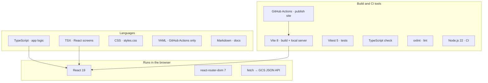

| Part | Tech | Why we use it |
|------|------|----------------|
| **Screens** | React 19 + TypeScript (TSX) | UI with clear types |
| **URLs** | `react-router-dom` (`BrowserRouter`) | Clean paths under `/ci-analyzer/...` |
| **Build / local run** | Vite 8 | Fast local work; `base: '/ci-analyzer/'` for GitHub Pages |
| **Look** | Plain CSS (`web/src/styles.css`) | No big CSS library |
| **Downloads** | Browser `fetch` → GCS JSON API (`?alt=media`) | Works with browser CORS rules |
| **Tests** | Vitest + Testing Library + jsdom | Unit tests; optional live smoke scripts |
| **Lint** | oxlint | Quick checks on TS/TSX |
| **Hosting** | GitHub Pages | Only static files from `web/dist` |
| **CI** | GitHub Actions | Install → test → build → publish |
| **Built-in knowledge** | TypeScript data from [openshift/release](https://github.com/openshift/release) | Workflow steps, LPAR map, guide text — **inside the JS bundle**, not loaded later |

**Languages in this repo**

| Language | Where | Role |
|----------|-------|------|
| **TypeScript / TSX** | `web/src/**` | The whole app |
| **CSS** | `web/src/styles.css` | Colors and layout |
| **JSON** | `package.json`, job files in GCS | Dependencies; `started.json`, `finished.json`, `prowjob.json` |
| **YAML** | `.github/workflows/pages.yml` | Publish pipeline |
| **Markdown** | `README.md`, `ARCHITECTURE.md` | Docs |
| **HTML** | `web/index.html`, build `404.html` | App shell; deep links on Pages |

There is **no** Node/Express/Python backend for the debugger. GitHub Pages only serves files.

---

## 3. Folders in the repo

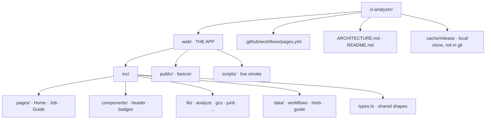

| Path | What it is |
|------|------------|
| `web/` | The product (Vite + React) |
| `web/src/pages/` | Full screens |
| `web/src/lib/` | Fetch + parse + analyze |
| `web/src/data/` | Fixed IBM Z CI knowledge |
| `web/scripts/` | Live GCS smoke tests |
| `.github/workflows/pages.yml` | Test, build, publish |
| `.cache/release/` | Optional local clone of openshift/release (ignored by git) |

---

## 4. Big picture

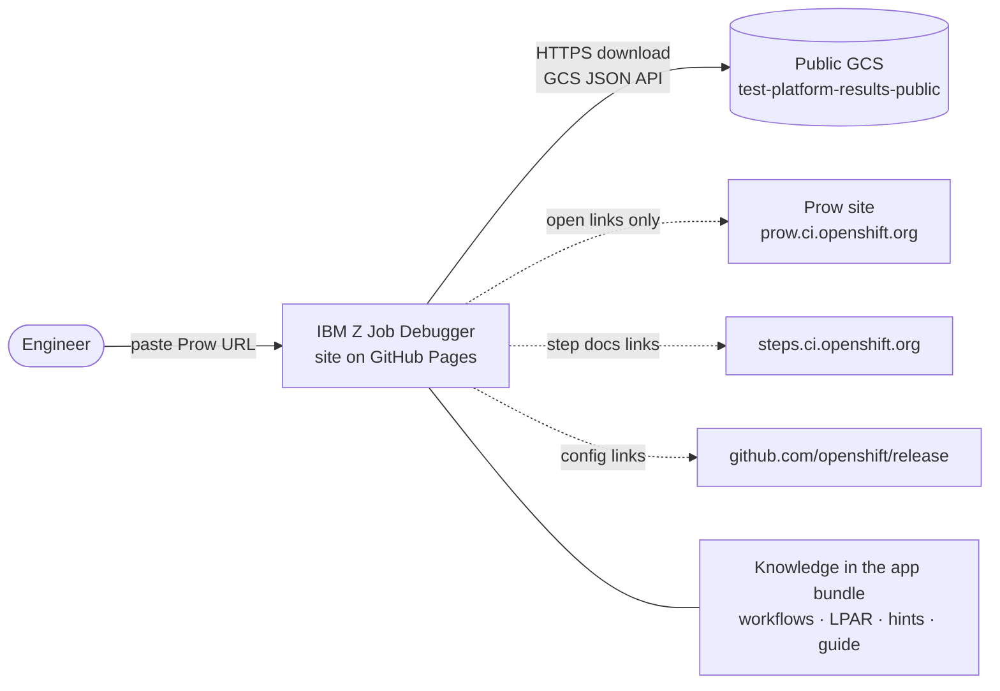

| Layer | Plain meaning |
|-------|----------------|
| **UI** | Single-page app under `/ci-analyzer/...` |
| **Brain** | `analyzeExecution()` in `web/src/lib/analyze.ts` |
| **Downloads** | `web/src/lib/gcs.ts` talking to public GCS |
| **Knowledge** | `web/src/data/*` baked into the build |
| **Publish** | GitHub Actions uploads `web/dist` |

**Key point:** We do **not** scrape Prow’s HTML. We only read the **public GCS files** that Prow already wrote for that job.

---

## 5. What the user does

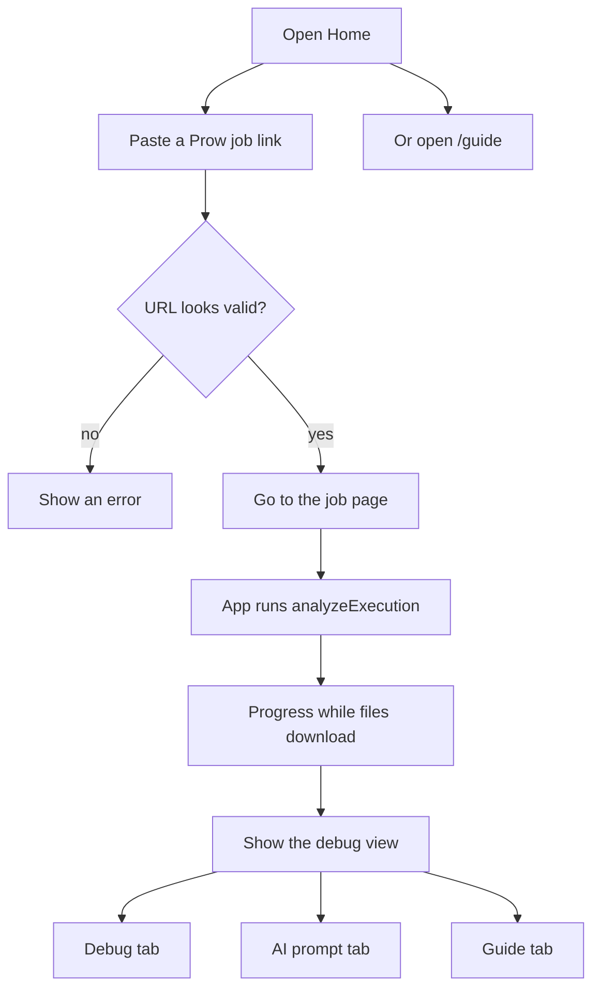

**Links we accept (examples)**

- `https://prow.ci.openshift.org/view/gs/test-platform-results-public/logs/<job>/<id>`
- Paths under the same public bucket

**Result:** one `DebugAnalysis` object (`web/src/types.ts`) that fills every panel.

---

## 6. Pages and URLs

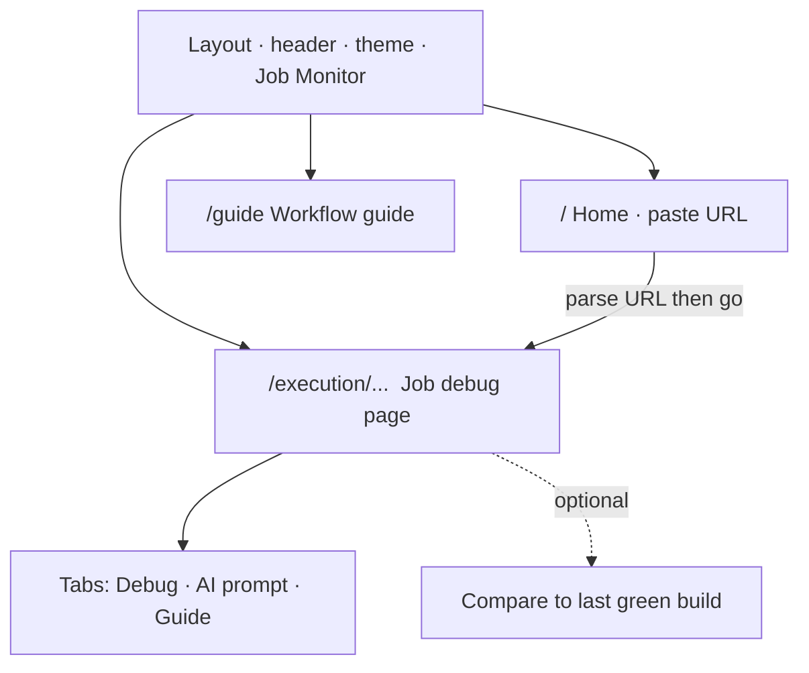

| URL | File | Job |
|-----|------|-----|
| `/` | `HomePage.tsx` | Paste / check URL |
| `/guide` | `WorkflowGuidePage.tsx` | Teach workflows |
| `/execution/...` | `ExecutionPage.tsx` | Full job analysis |
| anything else | redirect to `/` | Safety net |

**Why `404.html`?** GitHub Pages has no app server. A deep link like `/ci-analyzer/execution/...` must still load the app. The build copies `index.html` to `404.html` so that works.

**Base path:** Vite uses `/ci-analyzer/`. React Router uses the same path without the trailing slash.

---

## 7. Where job files live (GCS)

Default bucket: **`test-platform-results-public`**  
Usual path: `logs/<jobName>/<buildId>/` (or `pr-logs/...` for PRs)

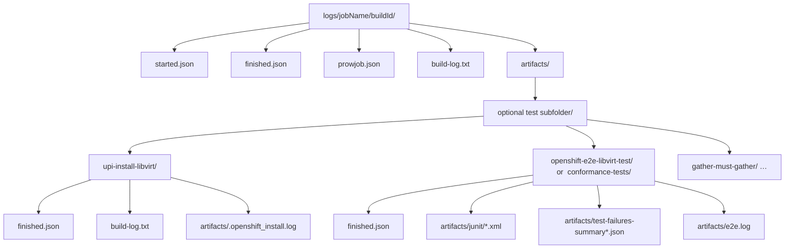

| File | What we use it for |
|------|--------------------|
| `started.json` / `finished.json` | Start/end time, pass/fail |
| `prowjob.json` | Job state, labels, profile |
| Root `build-log.txt` | Lease, profile, release lines |
| `artifacts/` listing | Find the test subfolder |
| Per-step `finished.json` | Step pass/fail and duration |
| Per-step `build-log.txt` | Failure text, libvirt host |
| `artifacts/release/...` | Nightly tag / image names |
| junit + failure summary JSON | Failed tests (blocking vs informing) |

### Why the GCS JSON API?

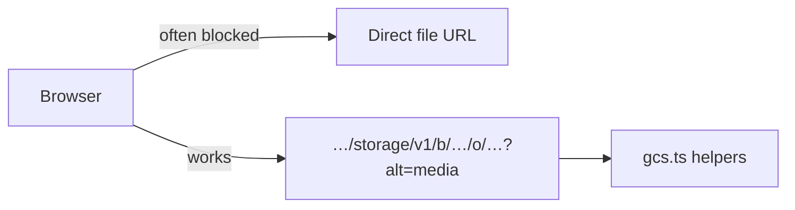

“Compare to last green” also lists builds from the **same GCS job folder** — still no HTML scraping.

---

## 8. Full flow for one job

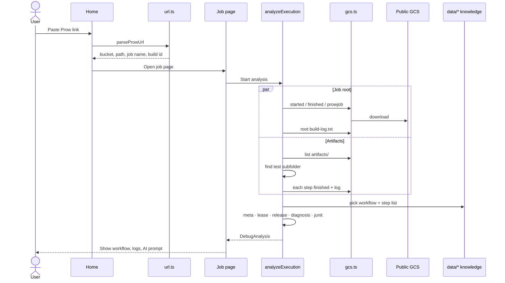

---

## 9. How analysis works

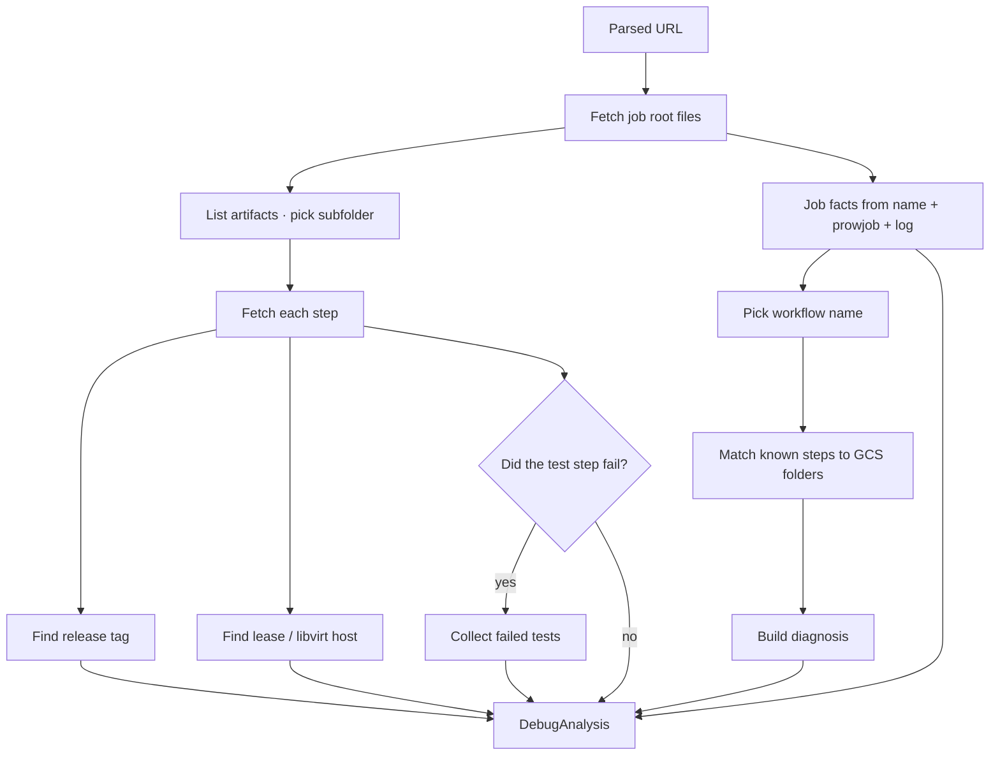

**Known steps vs folders on disk**

1. Guess the workflow from job name + cluster profile.
2. Load that workflow’s step list.
3. Match step names to folders under `artifacts/`.
4. If the job is still **RUNNING**, missing folders are **pending / current** — not treated as success.

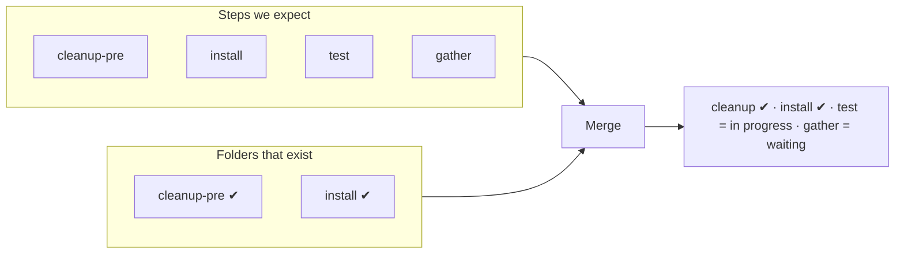

---

## 10. Workflows we know about

Common workflows for the IBM Z dashboard (from openshift/release):

| Workflow | Typical jobs | Test step name |
|----------|--------------|----------------|
| `openshift-e2e-libvirt-vpn` | z-z e2e, serial, upgrade, agent | `openshift-e2e-libvirt-test` |
| `openshift-e2e-libvirt-vpn-fips` | FIPS jobs | same (+ `fips-check` in PRE) |
| `openshift-e2e-libvirt-heterogeneous-vpn` | z-za / vpn-amd64 / vpn-arm64 | `openshift-e2e-libvirt-test` |
| `hypershift-mce-ibmz-conformance-…-oz` | MCE IBM Z HCP | `conformance-tests` |

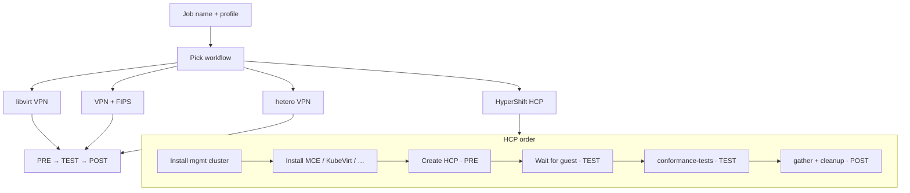

| File | Holds |
|------|--------|
| `web/src/data/vpnWorkflow.ts` | Step lists + workflow pick logic |
| `web/src/data/workflowGuide.ts` | Guide text for people |
| `web/src/data/stepInfo.ts` | Per-step tips |
| `web/src/data/lpar.ts` + lease helpers | Lease → host / LPAR |

For junit, HCP jobs use `conformance-tests`; VPN-family jobs use `openshift-e2e-libvirt-test`.

---

## 11. Failed tests: blocking vs informing

When the test step fails, we build a failed-test list close to how Prow / Sippy talk about severity.

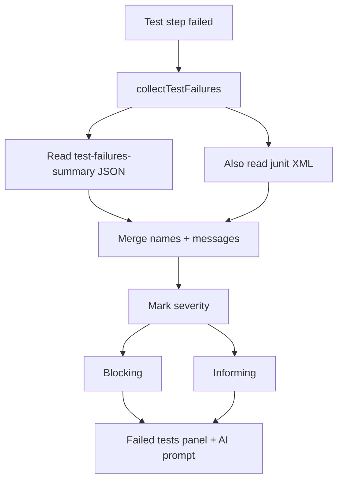

| Word | Meaning here |
|------|----------------|
| **Blocking** | Main failures that explain the suite fail |
| **Informing** | Extra / monitor fails that should not steal the main story |
| **Unknown** | Kept when we are not sure — we do not hide them |

Code: `web/src/lib/junit.ts`, called from `analyzeExecution`.

---

## 12. Code map

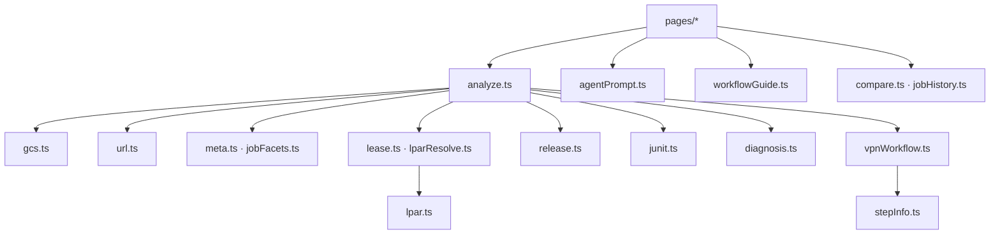

| Module under `web/src/` | Language | Job |
|-------------------------|----------|-----|
| `lib/url.ts` | TypeScript | Parse / encode Prow URLs |
| `lib/gcs.ts` | TypeScript | Download and list public files |
| `lib/analyze.ts` | TypeScript | Run the full analysis |
| `lib/meta.ts` / `jobFacets.ts` | TypeScript | Profile, topology, header pills |
| `lib/lease.ts` / `lparResolve.ts` | TypeScript | Lease → short host / LPAR |
| `lib/release.ts` | TypeScript | Nightly tag / images |
| `lib/junit.ts` | TypeScript | Failed tests |
| `lib/diagnosis.ts` | TypeScript | Facts, ideas, evidence links |
| `lib/compare.ts` / `jobHistory.ts` | TypeScript | Diff vs last green |
| `lib/agentPrompt.ts` | TypeScript | Copy-paste AI brief |
| `data/vpnWorkflow.ts` | TypeScript | Known workflows and steps |
| `data/*` guide / hints / LPAR | TypeScript | Teaching + tips |
| `pages/*.tsx` / `components/*.tsx` | TSX | UI |
| `types.ts` | TypeScript | Shared types |
| `styles.css` | CSS | Look and feel |

---

## 13. What you see on the job page

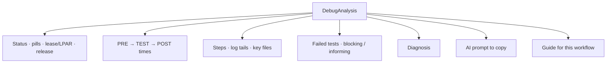

**Useful file links** (from `keyArtifactsFor()`):

| Step | Links we highlight |
|------|--------------------|
| `upi-install-libvirt` | `artifacts/.openshift_install.log` |
| `openshift-e2e-libvirt-test` / `conformance-tests` | `artifacts/junit/`, `artifacts/e2e.log` |
| `gather-must-gather` | `artifacts/must-gather.tar.gz` |
| HCP create step | `artifacts/` |

Theme and “recent jobs” stay in **`localStorage`** only (on your machine).

---

## 14. Build, test, and publish

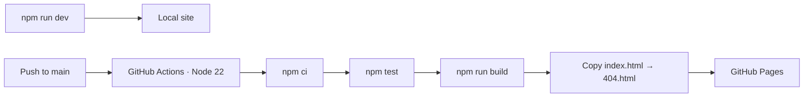

| Command (in `web/`) | What it does |
|---------------------|--------------|
| `npm install` | Install packages |
| `npm run dev` | Local app |
| `npm test` | Unit tests |
| `npm run build` | Typecheck + production files + `404.html` |
| `npm run lint` | Lint |
| `npx tsx scripts/smoke-all-workflows.mts` | Live check against real GCS jobs |

Publish runs on push to `main` when `web/**` (or the workflow file) changes, or when you start the workflow by hand.

---

## 15. Safety

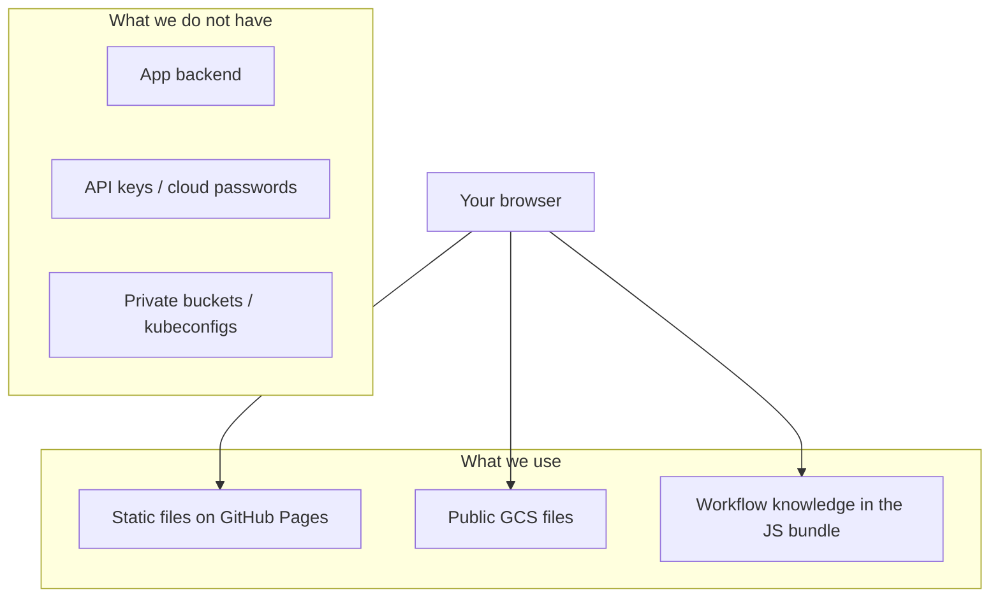

- We can only read what is already **public** on GCS.
- If GCS returns a “redacted” stub, we show that as redacted.
- The AI prompt is built **on your machine** for you to copy. This app does **not** call an LLM.

---

## 16. Simple word list

| Word | Plain meaning |
|------|----------------|
| **Prow** | OpenShift CI system and its web UI |
| **GCS** | Google Cloud Storage — where job logs and files are stored |
| **ci-operator** | Tool that expands a workflow into many small steps |
| **Workflow** | Named recipe of steps (from openshift/release) |
| **Leaf step** | One real folder under `artifacts/` (e.g. install or test) |
| **PRE / TEST / POST** | Three stages on the timeline |
| **Boskos lease** | Temporary claim on a libvirt machine slot |
| **Cluster profile** | e.g. `libvirt-s390x-vpn` or `libvirt-s390x-vpn-hcp` |
| **HCP** | Hosted control plane (HyperShift guest cluster) |
| **SPA** | Single-page app — routing happens in the browser |
| **CORS** | Browser rule that makes us use the GCS JSON API form |

---

## Remember this

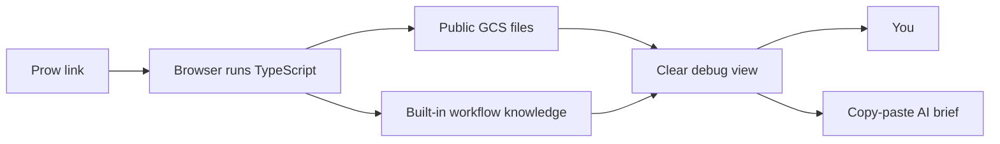

**Prow link in → public job files + built-in IBM Z knowledge → structured debug view** (workflow, failure focus, release/lease, failed tests, AI brief). All smarts run in the browser. GCS is the source of truth for what the job actually did.
