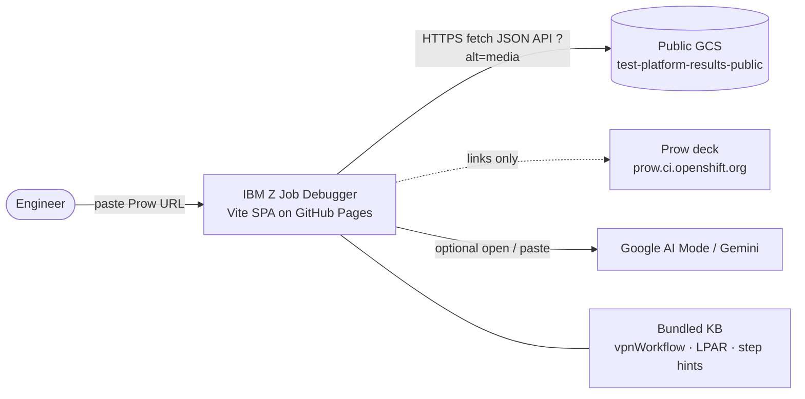
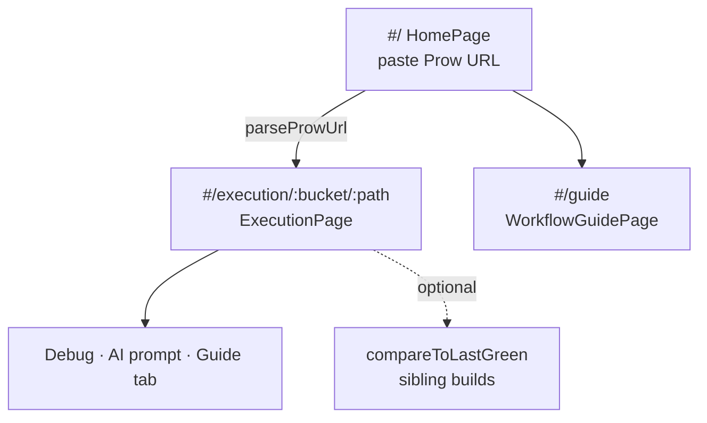
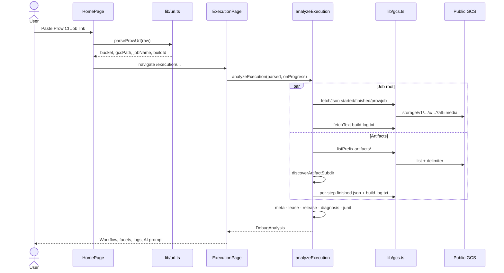
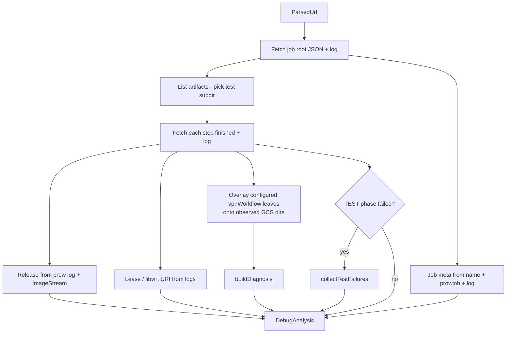
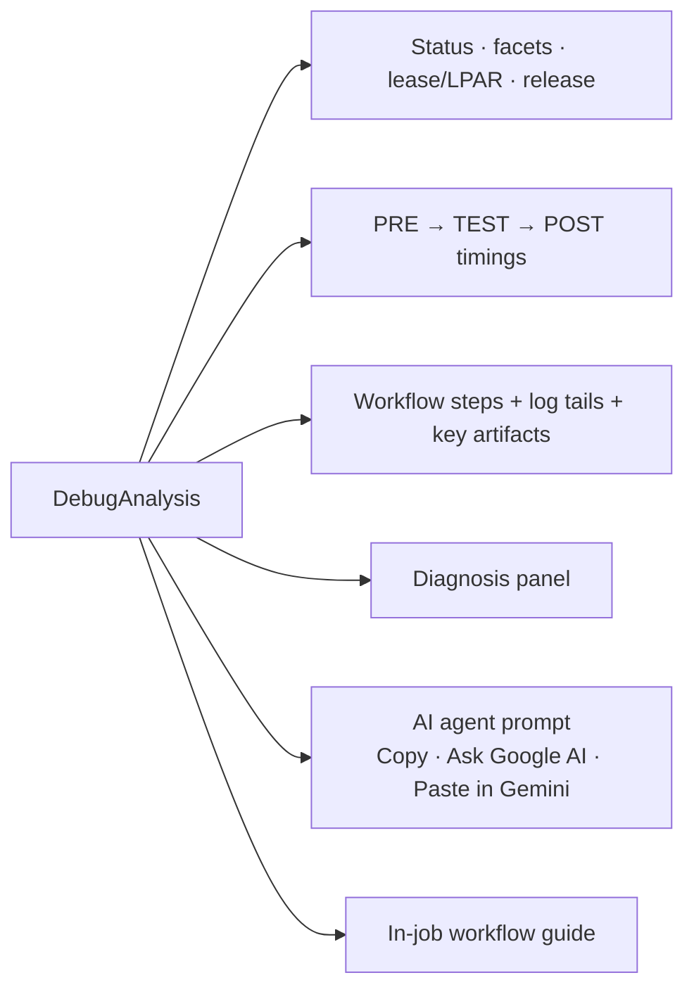
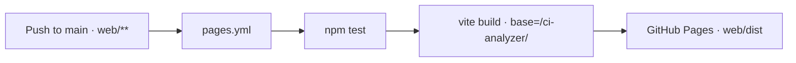

# IBM Z Job Debugger — high-level architecture

Client-only Vite/React SPA. Paste a Prow CI job link → the **browser** fetches public GCS artifacts → analysis runs **locally** → debug UI + AI prompt. **No app backend, no API keys, no private buckets.**

Live: [ibm-adarsh.github.io/ci-analyzer](https://ibm-adarsh.github.io/ci-analyzer)

---

## System context

| Layer | What it is |
|-------|------------|
| **UI** | `HashRouter` SPA under `/ci-analyzer/#/...` |
| **Orchestrator** | `analyzeExecution()` in `src/lib/analyze.ts` |
| **I/O** | `src/lib/gcs.ts` → GCS JSON API (CORS-safe) |
| **Knowledge** | `src/data/*` baked from openshift/release (not fetched at runtime) |
| **Deploy** | `.github/workflows/pages.yml` → `web/dist` |

---

## App routes

---

## End-to-end data flow (one job)

---

## What is fetched from where

Default bucket: **`test-platform-results-public`**  
Prefix shape: `logs/<jobName>/<buildId>/` (or `pr-logs/...`)

| GCS object | Used for |
|------------|----------|
| `started.json` / `finished.json` | Wall times, overall pass/fail |
| `prowjob.json` | Prow state, labels, refs |
| `build-log.txt` (root) | Lease, profile, release import lines |
| `artifacts/` listing | Find ci-operator test subdir |
| `artifacts/<test>/…/<step>/finished.json` | Step status + duration |
| `…/<step>/build-log.txt` | Failure tail, qemu/lease host |
| `artifacts/release/…/release-images-*` | Nightly tag / pullspecs |
| `…/junit/*.xml` + `test-failures-summary*.json` | Failed test cases (blocking vs informing) |

**Prow deck** is not scraped for analysis — only linked (`prowViewUrl` / history). Sibling builds for “vs last green” are listed from the same GCS job prefix.

**Fetch path:** browser → `https://storage.googleapis.com/storage/v1/b/<bucket>/o/<object>?alt=media` (via `gcsApiUrl`) so CORS works. Direct `storage.googleapis.com/<bucket>/path` often fails in-browser.

---

## Analyze pipeline (client-side)

**Configured vs observed:** leaf steps from `data/vpnWorkflow.ts` (openshift-e2e-libvirt-vpn family) are matched to GCS dirs. On a RUNNING job, missing dirs are **pending/current**, not success.

---

## Module map

| Module | Responsibility |
|--------|----------------|
| `lib/url.ts` | Prow URL ↔ route encoding |
| `lib/gcs.ts` | CORS-safe fetch/list |
| `lib/analyze.ts` | End-to-end orchestration → `DebugAnalysis` |
| `lib/meta.ts` / `jobFacets.ts` | Profile, topology, hero pills, config links |
| `lib/lease.ts` / `lparResolve.ts` | Boskos slot → short host / LPAR |
| `lib/release.ts` | Nightly tag / pullspecs |
| `lib/junit.ts` | Failed tests; blocking vs informing |
| `lib/diagnosis.ts` | Facts / hypotheses / evidence |
| `lib/compare.ts` / `jobHistory.ts` | Diff vs last green build |
| `lib/agentPrompt.ts` | IBM BOB brief + Google AI Mode / Gemini helpers |
| `data/vpnWorkflow.ts` | Configured PRE/TEST/POST leaves |
| `data/lpar.ts` / `stepInfo.ts` / `workflowGuide.ts` | Static Z CI knowledge |

---

## UI composition (execution)

---

## Deploy

- `HashRouter` avoids needing a Pages 404 rewrite for deep links.
- Theme + recent jobs stay in `localStorage` only.

---

## Mental model

**One composition:** Prow link in → public GCS evidence out → structured IBM Z debug context (workflow, failure focus, release/lease, copy-paste AI brief). All intelligence is in the browser; GCS is the source of truth.
